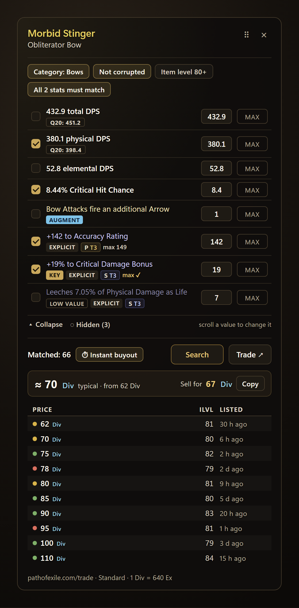

# PoE2 Price Check

A small overlay for Path of Exile 2: hover over an item, press **Ctrl+D**, and the price appears next to the cursor.

<p align="center">
  
</p>

> This product isn't affiliated with or endorsed by Grinding Gear Games in any way.

## Download

From the [latest release](https://github.com/Manu-Zaser/poe2-price-check/releases/latest), pick one:

| File | |
|---|---|
| **`PoE2-Price-Check-Setup-<version>.exe`** (recommended) | Installs for your Windows user (no admin rights) and **updates itself**: new versions are downloaded in the background and installed when you close the tool – or right away with "Restart now". |
| `PoE2-Price-Check-<version>.exe` | Portable, no installation. Cannot replace itself – the tool tells you when a new version is available and opens the download page. |

Settings are stored in `%APPDATA%\poe2-pricecheck` for both. The exe files are not signed: on first launch Windows
shows "Windows protected your PC" → "More info" → "Run anyway".
Play PoE2 in **windowed / windowed fullscreen** mode, otherwise the overlay ends up behind the game.

Update checks only ask github.com for the latest release – no data is sent.

## Running from source

```bash
npm install
npm start
```

## Main window

- **Home:** the hotkey, the price data (league, exchange rate, how many items poe.ninja prices and when they were
  updated) and your **recent checks** – click one to open it in the overlay again, without scanning or searching again.
- **How to use:** a short guide to the hotkey, the overlay and selling.
- **Settings:** overlay size, background and position, league, updates, GPU acceleration.

Closing the main window quits the tool.

**Changing the hotkey:** Home → "Change hotkey" → press the new combination. Allowed are Ctrl/Alt + key or a single
F key. Combinations such as Ctrl+C are rejected because the game needs them. Esc cancels.

**League:** "Automatic" follows the current challenge league on poe.ninja. Prices are refreshed every hour, so after a
league start the tool switches to the new league within an hour. A league you picked by hand that no longer exists
switches back to automatic.

## Features

- **Currency, fragments, runes, essences, gems, etc.** → price per unit and for the whole stack (poe.ninja)
- **Unidentified uniques** → all possible uniques for that base with their prices (poe.ninja)
- **Identified uniques** → trade search by name and base, with the same mod list as for rares. By default no mod is
  ticked, so you see the cheapest copies; tick a roll to search for copies that are at least as good as yours (all
  ticked rolls must match). The poe.ninja price ("any rolls") stays visible for comparison.

  

- **Normal (white) items** such as crafting bases or waystones → trade search like rares, with defaults for bases:
  only white items of **this base type** with at least **your item level**, same corrupted state. Implicits and
  defences are listed but not ticked. Anything poe.ninja knows (e.g. currency) is still priced via poe.ninja.
- **Rare and magic items** (and identified uniques) → search on the official trade site. The overlay is laid out
  like the trade site (top to bottom):
  - **Chips** for the filters you rarely change – click to switch: *Category / Base* (by default the whole item
    category, e.g. all bows – for rares the mods matter, not the base; click to search only this base type), *Not corrupted* (on by default), *Item level* and *Sockets* (scroll over the chip to change the value),
    and the match mode (*all ticked stats must match* – the default – or *most of them*, e.g. "3 of 5").
  - **Stat lines** with a checkbox, **Min** and **Max**. Under each mod: where it comes from (Explicit, Implicit,
    Augment = rune/soul core, Desecrated, Fractured …) and its tier (e.g. "P T7"; in PoE2 a higher tier is better).
    Tick or untick (clicking the text works too), change values with the **mouse wheel** or click and type them
    (empty = no limit). Default minimum = your item's own value (rounded down to one decimal place).
    "Reduced" mods (e.g. "50% reduced Projectile Range") are shown and edited as on the item; the search converts them.
  - Order: weapon DPS (total/physical/elemental, calculated from the item's properties) and the weapon's overall
    **critical hit chance** (as displayed, including base value, local mods and quality – the local
    "+#% to Critical Hit Chance" mod is hidden because it is already part of it), defences (armour, evasion,
    energy shield as displayed; block and spirit optional), **totals** (resistances, life, mana, attributes combined
    into pseudo stats – finds far more comparable items), then the item's mods.
  - **Hidden:** mods that are already counted in a total, the DPS or the defences, and mods the trade search does not
    know, are hidden by default. "Hidden (n)" shows them in place, marked "◌ in DPS" etc.
  - **Collapse** folds the stat list away so only chips and results remain. Both settings are remembered.
  - **Results bar:** number of matches, *Instant buyout* (on by default; off = also "in person" listings), **Search**
    and **Trade ↗** (opens the same search in your browser). Nothing is searched until you click **Search** – not
    even when the overlay opens, so you can check the stats first. The button lights up whenever there is something
    new to search. The result is added to the history in the main window.
  - **Summary:** the typical price (median of the 3 cheapest *current* listings – the single cheapest is often a
    forgotten or mispriced item) and a **suggested selling price** slightly below it, with a button to copy it as a
    stash note (e.g. `~b/o 58 exalted`; Exalted suggestions also show the Divine equivalent).
  - **Warnings** appear when the price is unreliable: fewer than 10 results, or only listings older than 14 days.
  - **Listings table** with the 20 cheapest offers (price, item level, listed). Listings older than 14 days are faded
    and ignored for the typical price (unless there are fewer than 2 current ones). Listings are sorted by their value
    according to poe.ninja (GGG sorts by its own rates).

poe.ninja is fetched at most once per hour, the trade search's stat list once per day
(`%APPDATA%\poe2-pricecheck\trade-stats.json`).

### Trade search and rate limits

Each rare price check sends **two to three** requests to pathofexile.com (one search + one or two fetches for the
20 cheapest listings; fetches have their own, more generous limit).
GGG currently allows about 5 searches per 10 s and 30 per 5 min; exceeding that gets you blocked for up to 30 min.
The tool reads the limits from every response, keeps one request in reserve and shows "please wait X s" instead of
retrying blindly. No login / POESESSID is used.

The trade endpoints (`/api/trade2`) are **not** part of GGG's officially documented API. All common price-check tools
use them; GGG may change them at any time.

## Rules (GGG developer docs)

- One hotkey press = **one** action in the game (a single Ctrl+Alt+C = advanced copy including tiers); the clipboard
  is read once per press.
- The copy keystroke is only sent when the "Path of Exile 2" window is in the foreground. If one of the tool's own
  windows is in front (e.g. after clicking into the overlay), the game window is brought back to the front first –
  a plain window switch, no input to the game. Otherwise only the current clipboard is checked (handy for testing).
- While the mouse is over the overlay, the overlay may take the focus so clicks reliably reach it; when the mouse
  leaves it or it is closed, the game gets the focus back.
- No memory reading, no client modification, no automation.

## Overlay

- Stays open until you close it with **×** (or Esc); a new price check replaces its content.
- Drag it by any empty spot to move it (a short click stays a click). The position is remembered and used for all
  further price checks (Settings → "Reset position" = back next to the mouse cursor).
- If the overlay content crashes, the window is recreated automatically so nothing invisible is left on top of the
  game. Errors are written to `%APPDATA%\poe2-pricecheck\poe2-pricecheck.log`.

## Performance

By default the tool renders **without GPU acceleration** so it doesn't take graphics performance away from the game.
Animations on top of the game only run in coarse steps. Configurable under Settings → Performance (restart required).

## Appearance

Under Settings you can set the **overlay size** (80–160%) and the **overlay background** opacity (40–100%). Lower
background values let the game show through; text, buttons and input fields stay fully visible. Both changes apply
immediately – check them with "Show test overlay".

## Configuration

Hotkey, league and overlay settings are set in the UI. Everything is stored in
`%APPDATA%\poe2-pricecheck\config.json`:

| Field | Default | Meaning |
|---|---|---|
| `league` | `""` | empty = current challenge league |
| `hotkey` | `Ctrl+D` | Electron accelerator |
| `gameWindowTitle` | `Path of Exile 2` | window title of the game |
| `contact` | `""` | optional additional contact in the User-Agent (the project URL is always sent) |
| `overlayScale` | `1.15` | overlay size (0.8–1.6) |
| `overlayOpacity` | `0.96` | opacity of the overlay background (0.4–1) |
| `overlayPosition` | `null` | remembered overlay position (`null` = at the mouse cursor) |
| `gpuAcceleration` | `false` | GPU acceleration for the app windows |

## Building the exe

```bash
npm run dist
```

Creates in `release/`:

- `PoE2-Price-Check-Setup-<version>.exe` – installer with automatic updates
- `PoE2-Price-Check-<version>.exe` – portable exe
- `latest.yml` and `PoE2-Price-Check-Setup-<version>.exe.blockmap` – needed by the auto-updater

To publish a version, raise `version` in `package.json`, build, and attach all four files to a GitHub release tagged
`v<version>`. Installed copies pick it up automatically; portable copies show a notice.

## Development

```bash
npm test           # Vitest (parser, price index, hotkeys, mod mapping, rate limits)
npm run typecheck  # tsc
```

Layout: `src/shared/parser.ts` (item text), `src/shared/hotkey.ts` (hotkey capture and validation),
`src/shared/mods.ts` + `src/shared/stats.ts` (mods → trade stats, search query), `src/main/trade.ts` +
`src/main/ratelimit.ts` (trade API), `src/main/rare.ts` (rare price check), `src/main/ninja.ts` (prices),
`src/main/win32.ts` (copy keystroke and window focus), `src/main/updater.ts` (updates), `src/main/index.ts` (hotkey, windows, IPC),
`src/renderer/` (main window `app.*`, overlay `overlay.*`).

Debug output of the results: set the environment variable `POE2PC_DEBUG=1`.

## License and legal

Code licensed under the [MIT License](LICENSE).

Path of Exile is a trademark of Grinding Gear Games. This project is an unofficial fan tool; it is not affiliated with,
endorsed by or reviewed by GGG. Game content (item texts, stat descriptions) belongs to GGG; price data comes from
[poe.ninja](https://poe.ninja). Requests to pathofexile.com and poe.ninja carry a User-Agent with the project URL so
the operators can identify the sender.
