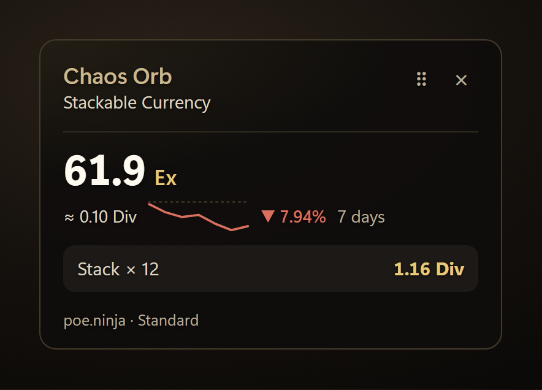
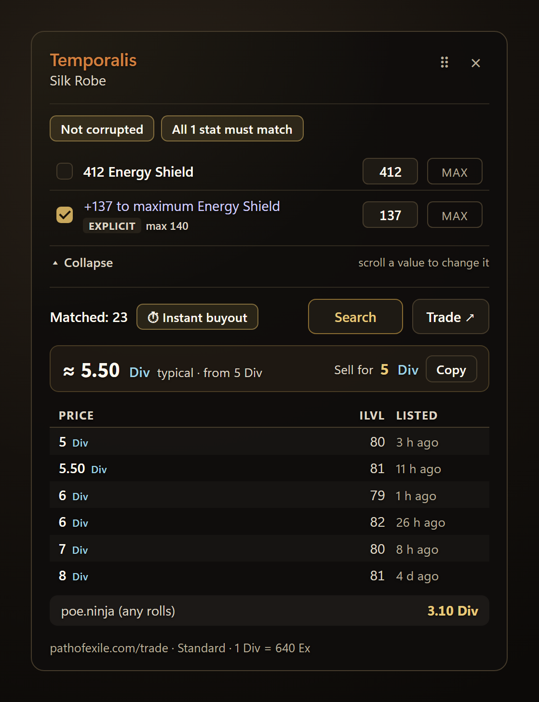
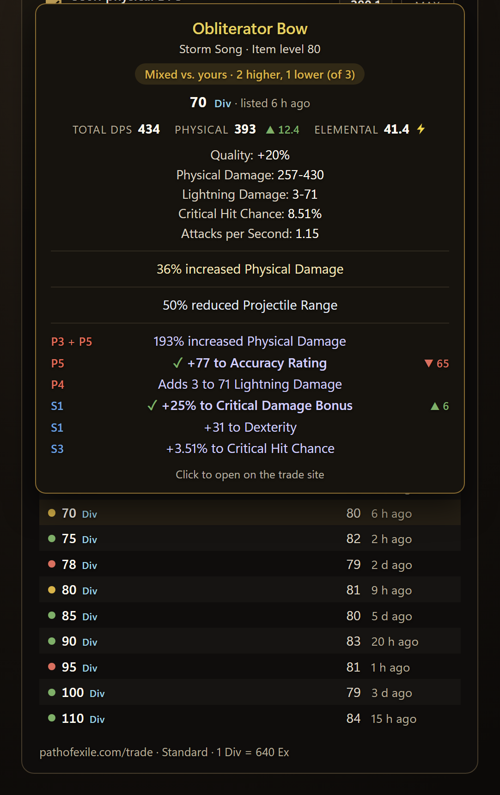
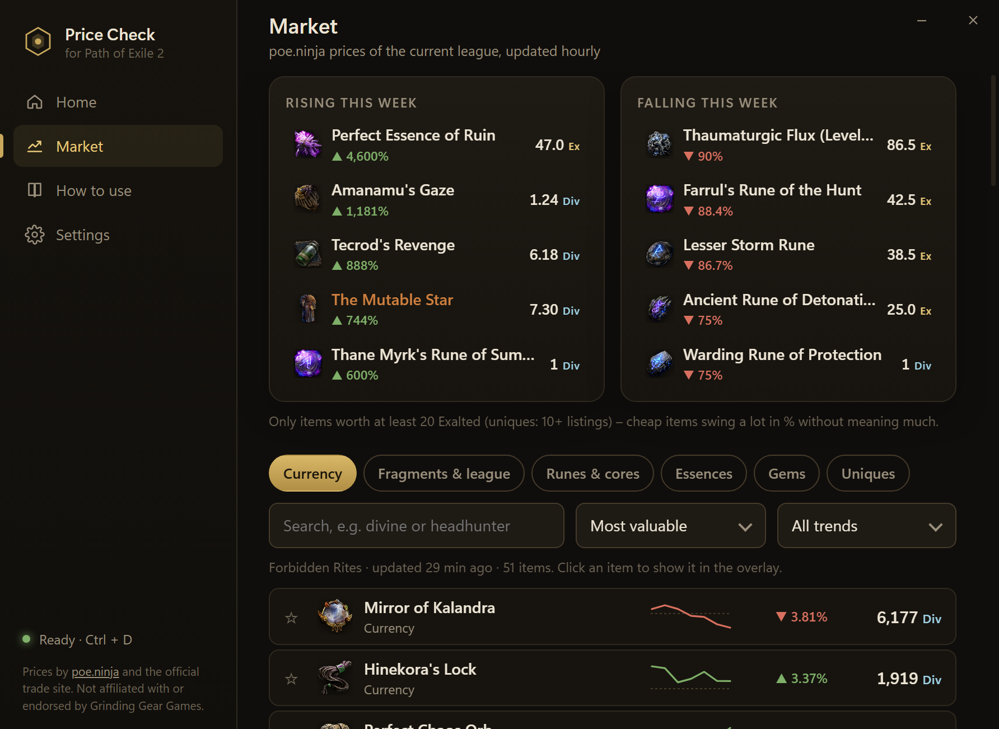
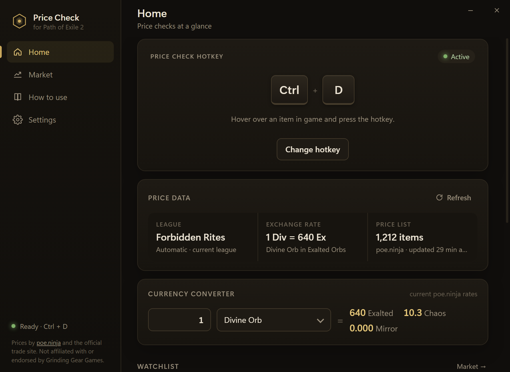

# PoE2 Price Check

A small overlay for Path of Exile 2: hover over an item, press **Ctrl+D**, and the price appears next to the cursor.

<p align="center">
  
</p>

> This product isn't affiliated with or endorsed by Grinding Gear Games in any way.

## Contents

- [Quick start](#quick-start)
- [Download](#download)
- [What it prices](#what-it-prices)
- [Rare and magic items](#rare-and-magic-items)
- [Listings: hover, compare, click](#listings-hover-compare-click)
- [Market and watchlist](#market-and-watchlist)
- [Main window](#main-window)
- [Hotkeys](#hotkeys)
- [Overlay and settings](#overlay-and-settings)
- [Trade search, rate limits and GGG rules](#trade-search-rate-limits-and-ggg-rules)
- [For developers](#for-developers)
- [License and legal](#license-and-legal)

## Quick start

1. Download **`PoE2-Price-Check-Setup-<version>.exe`** from the
   [latest release](https://github.com/Manu-Zaser/poe2-price-check/releases/latest) and run it.
2. Play PoE2 in **windowed / windowed fullscreen** mode (otherwise the overlay ends up behind the game).
3. Hover over an item in game and press **Ctrl+D**.
4. For rares: check the ticked stats, then click **Search**.

## Download

From the [latest release](https://github.com/Manu-Zaser/poe2-price-check/releases/latest), pick one:

| File | |
|---|---|
| **`PoE2-Price-Check-Setup-<version>.exe`** (recommended) | Installs for your Windows user (no admin rights) and **updates itself**: it checks for a new version at start (and every 6 hours or with "Check now"), asks before downloading it, and installs it when you close the tool – or right away with "Restart now". |
| `PoE2-Price-Check-<version>.exe` | Portable, no installation. Cannot replace itself – the tool tells you when a new version is available and opens the download page. |

- Settings are stored in `%APPDATA%\poe2-pricecheck` for both.
- The exe files are not signed: on first launch Windows shows "Windows protected your PC" → "More info" → "Run anyway".
- Update checks only ask github.com for the latest release – no data is sent. Nothing is downloaded without your OK.

## What it prices

| Item | What you get |
|---|---|
| **Currency, fragments, runes, essences, uncut gems** (by level) … | Price per unit and for the whole stack, with the 7-day trend as a small graph (poe.ninja) |
| **Skill gems** | Trade search by name with gem level and quality as filters (poe.ninja has no prices for cut gems) |
| **Unidentified uniques** | All possible uniques for that base with their prices (poe.ninja) |
| **Identified uniques** | Trade search by name and base; tick a roll to find copies at least as good as yours. The poe.ninja price ("any rolls") stays visible for comparison |
| **Rare and magic items** | Trade search with your item's stats – see [below](#rare-and-magic-items) |
| **Normal (white) items** such as crafting bases | Trade search for **this base type** with at least **your item level**, same corrupted state |
| **Waystones and tablets** | Dangerous mods marked red, with a warning at the top (list under Settings → Map mods) |

<p align="center">
  
  &nbsp;
  
</p>

Anything poe.ninja knows is priced via poe.ninja, even as a white item. For identified uniques no mod is ticked by
default, so you see the cheapest copies.

## Rare and magic items

The overlay is laid out like the trade site, top to bottom:

- **Chips** for the filters you rarely change – click to switch: *Category / Base* (by default the whole category,
  e.g. all bows – for rares the mods matter, not the base), *Not corrupted* (on by default), *Item level* and
  *Sockets* (scroll over the chip to change the value), and the match mode (*all ticked stats must match* or *most of
  them*, e.g. "3 of 5").
- **Stat lines** with a checkbox, **Min** and **Max**. Under each mod: where it comes from (Explicit, Implicit,
  Augment = rune/soul core, Desecrated, Fractured …) and its tier (e.g. "P T3"; in PoE2 a higher tier is better).
  Click to tick, change values with the **mouse wheel** or type them (empty = no limit). Default minimum = your
  item's own value.
- **Key mods:** a rare's price depends on 2–3 mods, not on all of them. Only the **key mods** of the item type are
  ticked by default (e.g. movement speed on boots, skill levels and Spirit on amulets, flat attack damage and rarity on
  rings), together with the totals for life and resistances. **Low value** mods (light radius, thorns, stun …) are
  faded and not searched. "ⓘ key mods … not on this item" lists what the item is missing.
- **Tier maximum:** next to each tier the highest value it can roll ("max 149"); a perfect roll shows a gold "max ✓".
- **Weapons:** total / physical / elemental DPS and critical hit chance as search filters. Below 20% quality,
  **Q20** sets the DPS at 20% quality as minimum. **Elemental DPS** lets you pick the element.
- **Results:** nothing is searched until you click **Search**, so you can check the stats first. You get the
  **typical price** (median of the 3 cheapest listings), a **suggested selling price** with a button to copy it as a
  stash note (e.g. `~b/o 58 exalted`), and the 20 cheapest listings – see the next section. **Trade ↗** opens the
  same search in your browser.

<details>
<summary><b>More details: totals, hidden mods, key mod lists, warnings</b></summary>

- Order of the stat lines: weapon DPS and the weapon's overall **critical hit chance** (as displayed, including base
  value, local mods and quality), defences (armour, evasion, energy shield; block and spirit optional), **totals**
  (resistances, life, mana, attributes combined into pseudo stats – finds far more comparable items), then the mods.
- **Hidden:** mods already counted in a total, the DPS or the defences, and mods the trade search does not know.
  "Hidden (n)" shows them in place, marked "◌ in DPS" etc. **Collapse** folds the stat list away. Both are remembered.
- "Reduced" mods (e.g. "50% reduced Projectile Range") are shown as on the item; the search converts them.
  Summed mods show one tier value per source line. Hover a tier for its full range and your roll in %.
- **Key mod and low value lists** can be edited under Settings → Mod value (`slot: text`, e.g.
  `boots: increased Movement Speed`; for attack weapons also `melee`, `ranged`, `bow`, `crossbow`). If an item has
  none of the key mods, all other mods are ticked. The defaults are based on research from November 2026 (poe2db mod
  tables for patch 0.5.x, the 0.5.0 patch notes and gear/selling guides); rules with thin evidence were left out, and
  shields/belts have no key mods on purpose.
- **Instant buyout** is on by default; off = also "in person" listings.
- A **warning** appears when there are fewer than 10 results. Old listings count like new ones – they can still be
  bought, and the search already filters for the stats you want.
- Listings are sorted by their value according to poe.ninja (GGG sorts by its own rates).
- Each search is added to the history in the main window.

</details>

## Listings: hover, compare, click

<p align="center">
  
</p>

- **Hover a row** to see the offered item. The window is laid out like the item view on the **official trade site**,
  so there is nothing new to learn and you find things where you already look for them: base type (with the item's
  name below), item level, price and age, **total / physical / elemental DPS** with element icons, the properties
  line by line, then the mods in game order – augments, implicit, prefixes and suffixes with their **tier in a column
  on the left** ("P3 + P5" for merged lines). ✓ marks mods you searched for.
- **Compared with your item:** the dot in front of each price shows whether the offer is **better** (green),
  **mixed** (yellow), **worse** (red) or the **same** (grey) on the stats you ticked. The hover window says how many
  stats are higher or lower and puts **▲/▼ with the difference** next to each mod, DPS value and total (life,
  resistances, attributes).
  - It counts stats instead of adding them up into one score, because what 10 life are worth against 5% resistance
    depends on your build.
  - Key mods count double; low-value and "reduced" mods are left out; a stat the offer lacks counts as lower.
  - It compares with the item you scanned, not with your equipped gear (the tool cannot see that).
- **Click a row** to open the trade site with the same search narrowed to that seller, so the offer is on top.

## Market and watchlist

<p align="center">
  
</p>

The **Market** page shows all poe.ninja prices of the current league – the same data the price check uses, so it
sends **no extra requests**:

- **Categories:** Currency, Fragments & league items, Runes & soul cores, Essences, Gems, Uniques – each with price,
  7-day graph and change. Search works across all categories; sort by value, rising, falling or name.
- **Rising / Falling this week:** the biggest movers among items worth at least 20 Exalted (uniques with 10+
  listings) – cheap items swing a lot in % without meaning much.
- **Trend signals:** a small badge describes what the 7-day curve did – **Steady climb** (up on most days),
  **Accelerating** (rising faster over the last two days), **Recovering** (fell, now clearly rising again),
  **Spike** (most of the rise in one recent day – often hype or price fixing) and **Sliding** (down on most days, near
  its weekly low). Filter by signal to see e.g. all steady climbers across categories. Signals only appear for items
  worth 5+ Exalted. They describe the last 7 days – **they don't predict prices**; patches, build trends and new
  crafting methods move prices in ways no curve shows.
- **Watchlist:** star (☆) an item to pin it to the Home page, e.g. the currency and runes you farm.
- **Click an item** to show it in the overlay like a price check.
- Prices update hourly (as often as poe.ninja recalculates). Uniques with fewer than 5 listings often have fantasy
  prices; they are hidden in the list and only shown – marked – when you search for them.
- Rares are not in the market list: there is no aggregated data for them, and polling the trade site would break
  its rate limits. Use the price check for rares.

## Main window

<p align="center">
  
</p>

- **Home:** the hotkey, the price data (league, exchange rate, how many items poe.ninja prices and when), a
  **currency converter** (Divine / Exalted / Chaos / Mirror of Kalandra at current rates), your **watchlist** and
  your **recent checks** – click one to open it in the overlay again, without scanning or searching again.
- **Market:** all poe.ninja prices with trends, top movers and search – see [above](#market-and-watchlist).
- **How to use:** a short guide to the hotkeys, the overlay, waystones and selling.
- **Settings:** hotkeys, startup, overlay size/background/position, league, map mods, mod value, updates, GPU
  acceleration.
- **Tray:** closing the main window keeps the tool running in the tray (next to the clock) – the hotkeys keep
  working. Quit with right-click on the tray icon → Quit. Under Settings → Startup you can turn this off or let the
  tool **start with Windows** (quietly in the tray). For the portable exe, Windows starts it from where it is when
  you tick the option – tick it again if you move the file.

## Hotkeys

| Default | Action |
|---|---|
| **Ctrl+D** | Price check – opens the overlay for the item under the cursor |
| **Ctrl+Alt+D** | Opens the item on pathofexile.com/trade in your browser, with the same default filters as the overlay (one trade search) |
| **Alt+W** | Opens the unique – or the item's base – on [poe2wiki.net](https://www.poe2wiki.net) |

Each press sends exactly one copy keystroke to the game. Change them under Settings → Hotkeys (the two extra hotkeys
can be turned off): press the new combination – Ctrl/Alt + key or a single F key. Combinations such as Ctrl+C are
rejected because the game needs them. Esc cancels.

## Overlay and settings

- **Overlay:** stays open until you close it with **×** (or Esc); a new price check replaces its content. Drag it by
  any empty spot to move it – the position is remembered (Settings → "Reset position" = back next to the cursor).
  If the overlay content crashes, the window is recreated so nothing invisible is left on top of the game.
- **Appearance:** overlay size (80–160%) and background opacity (40–100%) – lower values let the game show through;
  text and buttons stay fully visible. Check with "Show test overlay".
- **League:** "Automatic" follows the current challenge league on poe.ninja and switches to a new league within an
  hour of its start. A league you picked by hand that no longer exists switches back to automatic.
- **Performance:** by default the tool renders **without GPU acceleration** so it doesn't take graphics performance
  away from the game (Settings → Performance, restart required).
- **Data:** poe.ninja is fetched at most once per hour, the trade search's stat list once per day. Errors are written
  to `%APPDATA%\poe2-pricecheck\poe2-pricecheck.log`.

## Trade search, rate limits and GGG rules

Each rare price check sends **two to three** requests to pathofexile.com (one search + one or two fetches for the
20 cheapest listings). GGG currently allows about 5 searches per 10 s and 30 per 5 min; exceeding that gets you
blocked for up to 30 min. The tool reads the limits from every response, keeps one request in reserve and shows
"please wait X s" instead of retrying blindly. No login / POESESSID is used. Opening a listing on the trade site
(click on a row) needs no extra request.

The trade endpoints (`/api/trade2`) are **not** part of GGG's officially documented API. All common price-check tools
use them; GGG may change them at any time.

Following GGG's developer docs:

- One hotkey press = **one** action in the game (a single Ctrl+Alt+C = advanced copy including tiers); the clipboard
  is read once per press.
- The copy keystroke is only sent when the "Path of Exile 2" window is in the foreground. If one of the tool's own
  windows is in front, the game window is brought back to the front first – a plain window switch, no input to the
  game. Otherwise only the current clipboard is checked.
- While the mouse is over the overlay, the overlay may take the focus so clicks reliably reach it; when the mouse
  leaves it or it is closed, the game gets the focus back.
- No memory reading, no client modification, no automation.

## For developers

The item parser, hotkey handling, the one-keystroke item copy, the Win32 helpers and logging live in the shared
[`@poe2/core`](https://github.com/Manu-Zaser/poe2-core) package. Clone it **next to** this repository – the tool
references it as `../core`:

```bash
git clone https://github.com/Manu-Zaser/poe2-core.git core
git clone https://github.com/Manu-Zaser/poe2-price-check.git price-check
cd price-check
```

```bash
npm install
npm start          # run from source
npm test           # Vitest
npm run typecheck  # tsc
npm run dist       # build the exe files into release/
```

`npm run dist` creates the installer (`PoE2-Price-Check-Setup-<version>.exe`), the portable exe, and `latest.yml` +
the `.blockmap` for the auto-updater. Debug output of the results: set `POE2PC_DEBUG=1`.

**GitHub Actions** (`.github/workflows/`):

- **CI** – every push to `main` and every pull request: type check, tests and build (with the core checked out next
  to it). *Run workflow* on the Actions page can also build the exe files and attach them to the run for testing.
- **Release** – publishing a new version:
  1. Raise `version` in `package.json` and commit.
  2. Tag and push: `git tag v<version>` and `git push origin v<version>` (the tag must match `version`).
  3. The workflow builds all four files and creates a **draft** release with the download table and SHA-256 sums.
  4. Write the *What's new* section in the draft and publish it – only then does the auto-update offer it.

<details>
<summary><b>Project layout</b></summary>

From `@poe2/core`: item text parsing and mod lines (`item`), hotkey capture and validation (`hotkey`), the copy
keystroke and window focus (`win32`, `clipboard`), the log file (`log`), the trade API client with its rate limiter
(`trade`).

In this repository: `src/shared/stats.ts` (mods → trade stats, search query), `src/shared/listing.ts` (listing
details), `src/shared/compare.ts` (comparison with your item), `src/shared/market.ts` (market page), `src/main/rare.ts` (rare price check), `src/main/ninja.ts` (prices), `src/main/updater.ts` (updates),
`src/main/index.ts` (hotkey, windows, IPC), `src/renderer/` (main window `app.*`, overlay `overlay.*`).

</details>

<details>
<summary><b>Configuration file</b> (<code>%APPDATA%\poe2-pricecheck\config.json</code>)</summary>

Everything can be set in the UI; this is where it is stored.

| Field | Default | Meaning |
|---|---|---|
| `league` | `""` | empty = current challenge league |
| `hotkey` | `Ctrl+D` | price check hotkey (Electron accelerator) |
| `hotkeyTrade` | `Ctrl+Alt+D` | open on trade site (`""` = off) |
| `hotkeyWiki` | `Alt+W` | open in wiki (`""` = off) |
| `closeToTray` | `true` | closing the window keeps the tool running in the tray |
| `startWithWindows` | `false` | start with Windows (packaged exe only) |
| `dangerMods` | list | text snippets of dangerous waystone/tablet mods |
| `keyMods` | list | key mods per item type (`slot: text`) – searched by default |
| `lowMods` | list | low-value mods (`slot: text`, `*` = all) – faded, not searched |
| `watchlist` | `[]` | items starred on the Market page (shown on Home) |
| `gameWindowTitle` | `Path of Exile 2` | window title of the game |
| `contact` | `""` | optional additional contact in the User-Agent (the project URL is always sent) |
| `overlayScale` | `1.15` | overlay size (0.8–1.6) |
| `overlayOpacity` | `0.96` | opacity of the overlay background (0.4–1) |
| `overlayPosition` | `null` | remembered overlay position (`null` = at the mouse cursor) |
| `gpuAcceleration` | `false` | GPU acceleration for the app windows |

</details>

## License and legal

Code licensed under the [MIT License](LICENSE).

Path of Exile is a trademark of Grinding Gear Games. This project is an unofficial fan tool; it is not affiliated with,
endorsed by or reviewed by GGG. Game content (item texts, stat descriptions) belongs to GGG; price data comes from
[poe.ninja](https://poe.ninja). Requests to pathofexile.com and poe.ninja carry a User-Agent with the project URL so
the operators can identify the sender. The screenshots show the real UI with made-up listings; the market screenshot uses a poe.ninja snapshot.
